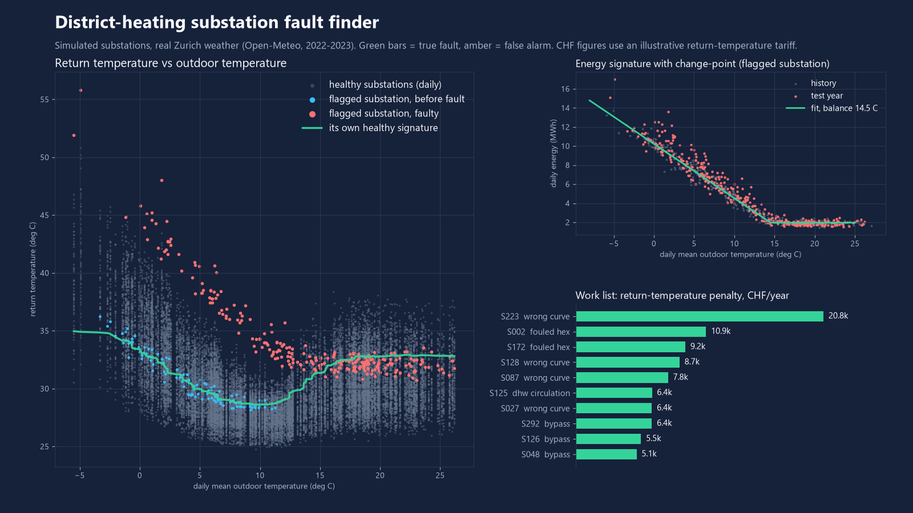
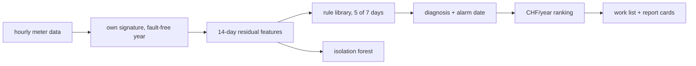

# dh-substation-fault-finder

Finds district-heating substations that return water too hot, names the likely fault, and ranks them by estimated CHF per year.



## What it does

- Learns each substation's own fault-free signature (return temperature, flow, energy versus outdoor temperature and time of day) from a year of hourly meter data.
- Scores new days against that signature and applies an explainable rule library for 8 fault types: fouled heat exchanger, bypass, stuck valve, wrong heating curve, DHW circulation, sensor swap, sensor drift, missing night setback.
- Turns the excess return temperature into an illustrative CHF/year figure (flow x excess K x tariff) and writes a ranked technician work list plus a Markdown report card per substation.
- Compares against an isolation-forest anomaly model and a supervised classifier trained on a different simulated network.
- Evaluates the signature and isolation-forest detectors on a public labelled benchmark of real substations.

## Results

All numbers come from `python -m dhfault demo` (simulated) and `python -m dhfault predist` (real open data). Rule thresholds were hand-set on a separate tuning network (seed 11); results are on a held-out network (seed 21).

**Simulated network** (300 substations, 48 with an injected fault, 6 per type, real Zurich hourly weather 2022 history + 2023 test year; the substations are simulated, so these are not field results):

| Method | Detected faulty | False-alarm substations (of 252 healthy) | Precision | Recall |
|---|---|---|---|---|
| Rule library | 48 / 48 | 1 | 0.98 | 1.00 |
| Isolation forest (unsupervised) | 47 / 48 | 11 | 0.81 | 0.98 |
| Supervised classifier | 48 / 48 | 27 | 0.62 | 1.00 |

- Diagnosis macro-F1 per fault type: rules 0.79, supervised 0.75. Weak spots for rules: stuck valve (recall 0.50), sensor drift (recall 0.50).
- Median alarm delay after onset: 14.5 days (90th percentile 140 days; fouled exchanger is slow, median 160 days).
- Top 10% of the work list (30 substations): all 30 truly faulty.
- Estimated recoverable cost after alarm for detected physical faults: 66.7k CHF versus 67.9k CHF true in the simulation (-1.8%), Spearman 0.99. The tariff is illustrative, so the CHF scale is too; the ranking is the point.

**Real open data** (public labelled benchmark, 93 substations, 52 fault reports and 61 normal periods evaluable, see Data sources). Detection before the customer report, trained on the history before each fault:

| Method | Faults caught before report | Normal periods with alarm | Precision | Mean lead time |
|---|---|---|---|---|
| Isolation forest | 21 / 52 (40%) | 0 / 61 | 1.00 | 6.5 days |
| Signature z-score | 16 / 52 (31%) | 1 / 61 | 0.94 | 7.9 days |

Most real faults are not visible in these hourly signals, so recall is modest; the useful result is that alarms are rare on normal periods.

## Quick start

```bash
pip install -e ".[dev]"
python -m dhfault demo --figures docs --out docs/demo   # about 5 minutes
python -m dhfault predist --fetch                       # downloads ~270 MB into cache/
python -m dhfault analyse my_meters.csv --ref-days 365  # your own hourly data
pytest
```

`analyse` expects columns `substation,time,t_out,t_supply,t_return,flow_lph,power_kw`.

## How it works



Residuals are flow-weighted return-temperature excess, flow and energy deviation, split by load level and day/night, scaled by each substation's own healthy variability. An alarm needs the same label on 5 of 7 days. Sensor faults are costed as unmetered energy, not as a return-temperature penalty.

## Data sources

- Weather: Open-Meteo historical archive, hourly 2 m temperature, Zurich, 2022-2023 (CC BY 4.0). Weather data by Open-Meteo.com.
- Real substations: "PreDist" labelled district-heating dataset, Zenodo, doi:10.5281/zenodo.17522255 (CC BY 4.0). Downloaded on demand, not stored in this repo.
- All other substations, faults and tariffs are simulated.

## What is not verified yet

- No field data from a real network with confirmed fault types; diagnosis accuracy is only measured on simulated faults, which share assumptions with the rules.
- The real-data benchmark has coarse labels, so recall there says little about per-type diagnosis.
- The CHF tariff is illustrative, not a real contract.
- Rule thresholds are tuned on one simulator and may need retuning for other networks.

## Licence

MIT, Copyright (c) 2026 Victor Bonilla.
